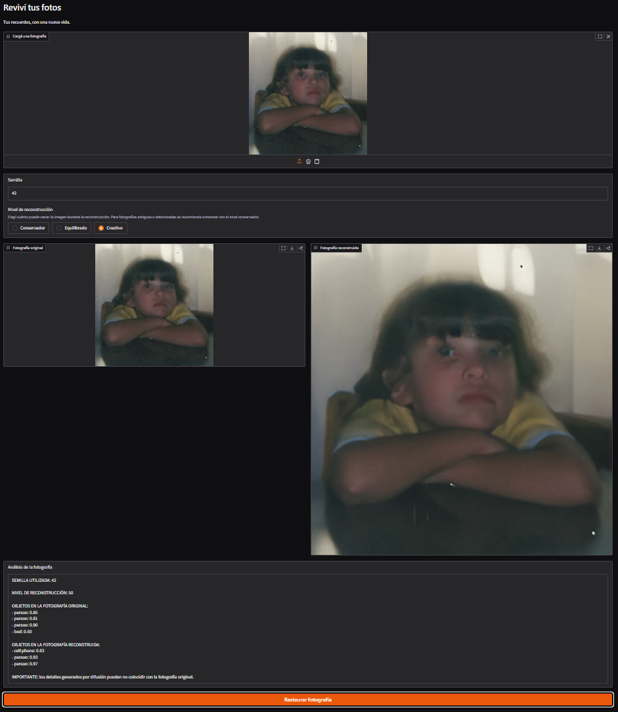

# Reviví tus fotos

**Aplicación de inteligencia artificial para mejorar y reconstruir fotografías mediante modelos de difusión.**

## Descripción del proyecto

Reviví tus fotos es una aplicación que permite mejorar fotografías mediante inteligencia artificial, utilizando modelos de difusión para generar una versión reconstruida de la imagen original.

El proyecto busca ofrecer una experiencia sencilla para personas sin conocimientos técnicos, permitiendo cargar una fotografía, seleccionar el nivel de reconstrucción y comparar el resultado obtenido.

## Usuario objetivo

Personas que desean mejorar o recuperar fotografías familiares antiguas, deterioradas o de baja calidad, sin necesidad de utilizar herramientas complejas de edición.

## Interfaz de la aplicación



## Funcionalidades principales

- Carga de fotografías.
- Reconstrucción mediante Stable Diffusion x4 Upscaler.
- Selección de tres niveles de reconstrucción: Conservador, Equilibrado y Creativo.
- Configuración de semilla para controlar la generación.
- Comparación entre fotografía original y reconstruida.
- Análisis de objetos detectados en ambas imágenes mediante DETR.

## Tecnologías y modelos utilizados

- Python 3.12
- Gradio: desarrollo de la interfaz.
- Gradio Client: comunicación entre la interfaz local y el backend remoto.
- Google Colab: ejecución de los modelos de inteligencia artificial.
- PyTorch y Diffusers.
- Stable Diffusion x4 Upscaler.
- DETR (DEtection TRansformer).
- Hugging Face Transformers.
- Pillow: procesamiento de imágenes.
- uv: gestión del entorno y dependencias.

## Arquitectura

La aplicación utiliza una arquitectura distribuida:

1. **Interfaz local:** desarrollada con Gradio y ejecutada desde VS Code.
2. **Backend remoto:** alojado en Google Colab, donde se ejecutan los modelos de inteligencia artificial.
3. **Comunicación:** Gradio Client conecta la interfaz local con el backend remoto.

Esta arquitectura permite utilizar modelos que requieren recursos de hardware superiores a los disponibles en el equipo local.

## Instalación y ejecución

### Requisitos

- Python 3.12
- uv
- Google Colab con GPU habilitada

### Pasos

1. Clonar el repositorio:

```bash
git clone https://github.com/Carlos-Estigarribia/revivi-tus-fotos.git
cd revivi-tus-fotos
```

2. Instalar las dependencias:

```bash
uv sync
```

3. Ejecutar el notebook `notebooks/backend_colab.ipynb` en Google Colab y completar la inicialización del backend.

4. Copiar la URL pública de Gradio generada por Colab y actualizar la variable `BACKEND_URL` en `app.py`.

5. Ejecutar la aplicación local:

```bash
uv run python app.py
```

**Importante:** el backend de Google Colab debe permanecer activo mientras se utiliza la aplicación. Si se reinicia la sesión, será necesario actualizar la URL pública en `app.py`.

## Uso

1. Cargar una fotografía.
2. Seleccionar una semilla.
3. Elegir el nivel de reconstrucción.
4. Presionar «Restaurar fotografía».
5. Comparar la imagen original con la reconstruida.
6. Consultar el análisis de objetos detectados.

## Decisiones de diseño centradas en el usuario

La interfaz se diseñó considerando la experiencia de una persona sin conocimientos técnicos:

- Lenguaje simple y directo.
- Instrucciones claras.
- Comparación visual entre original y resultado.
- Opciones predefinidas en lugar de parámetros técnicos complejos.
- Controles para elegir el nivel de reconstrucción.

## Limitaciones

Los modelos de difusión generan detalles visuales plausibles, pero no recuperan necesariamente la información original que se perdió o deterioró.

Por este motivo, la imagen reconstruida puede presentar diferencias respecto de la fotografía original. El análisis de DETR permite comparar los objetos detectados, pero no garantiza la fidelidad de la reconstrucción.

La aplicación requiere conexión con Google Colab y disponibilidad de una sesión con recursos de procesamiento adecuados.

## Trabajo futuro

- Incorporar nuevas herramientas de restauración.
- Mejorar el tratamiento de fotografías con daños severos.
- Ampliar las opciones de configuración.
- Optimizar los tiempos de procesamiento.
- Incorporar nuevas métricas para evaluar los resultados.

## Autoría

Trabajo Integrador 2 – Técnicas de Procesamiento Digital de Imágenes e Introducción a Visión por Computadora.

**Institución:** IFTS N.º 24.

**Autor:** Carlos Estigarribia.

**Año:** 2026.

